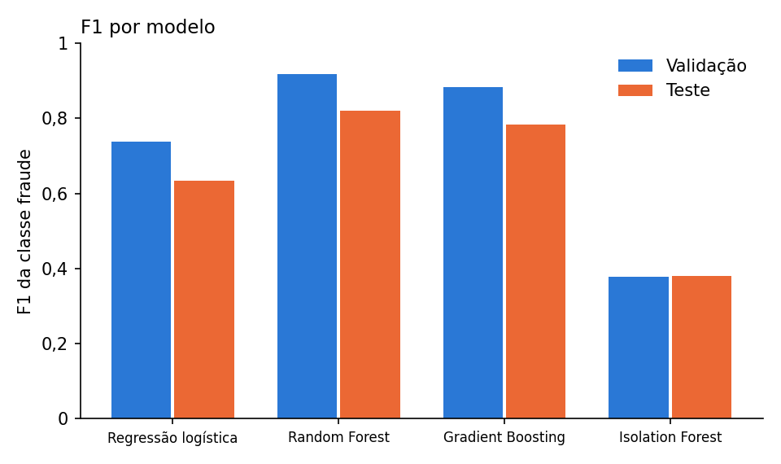
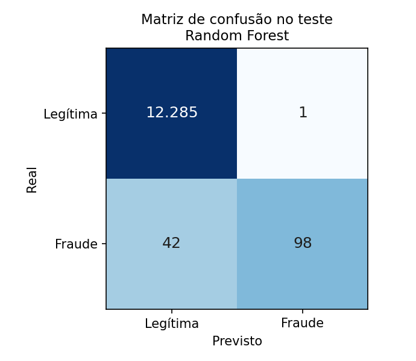
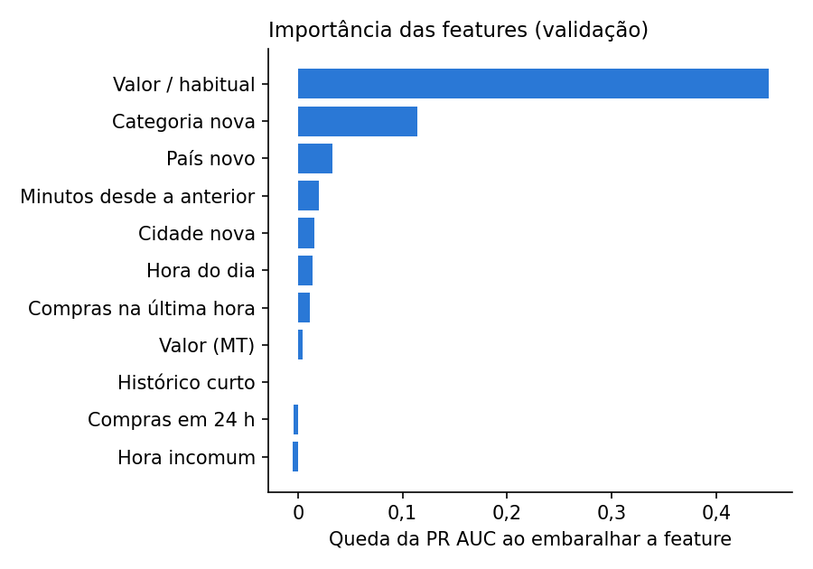

# Relatório do treino

Gerado por `python treinar.py` em 2026-11-07T17:18:55, em 74,2 s. Dados sintéticos, gerados para a disciplina; os resultados não valem para fraudes reais.

## Dados

70.972 transações de 300 clientes, com 713 fraudes (1,0%).

| Tipo de fraude | Transações |
|---|---|
| Valor alto | 75 |
| País estranho | 75 |
| Horário estranho | 74 |
| Rajada | 415 |
| Conta tomada | 74 |

## Períodos

A divisão é por tempo: cada período só vem depois do anterior. As features usam só o passado de cada cliente.

| Período | Início | Fim | Transações | Fraudes |
|---|---|---|---|---|
| Aquecimento | 2026-01-01 | 2026-01-30 | 15.520 | 120 |
| Treino | 2026-01-31 | 2026-03-29 | 33.693 | 322 |
| Validação | 2026-03-30 | 2026-04-12 | 9.333 | 131 |
| Teste | 2026-04-13 | 2026-04-30 | 12.426 | 140 |

## Modelos

Métricas da classe fraude. A acurácia engana: com cerca de 1% de fraudes, dizer "legítima" para tudo já dá 99% de acurácia.

| Modelo | Período | Precisão | Recall | F1 | PR AUC | Acurácia |
|---|---|---|---|---|---|---|
| Regressão logística | Validação | 75,8% | 71,8% | 0,737 | 0,754 | 99,3% |
| Regressão logística | Teste | 69,8% | 57,9% | 0,633 | 0,619 | 99,2% |
| Random Forest | Validação | 99,1% | 85,5% | 0,918 | 0,920 | 99,8% |
| Random Forest | Teste | 99,0% | 70,0% | 0,820 | 0,849 | 99,7% |
| Gradient Boosting (HistGradientBoosting) | Validação | 98,1% | 80,2% | 0,882 | 0,912 | 99,7% |
| Gradient Boosting (HistGradientBoosting) | Teste | 96,8% | 65,7% | 0,783 | 0,849 | 99,6% |
| Isolation Forest | Validação | 32,1% | 45,8% | 0,377 | 0,324 | 97,9% |
| Isolation Forest | Teste | 34,1% | 42,9% | 0,380 | 0,292 | 98,4% |

## Modelo escolhido

**Random Forest.** Maior F1 na validação (0,918). A regra foi fixada antes do treino: o limiar e o modelo vêm só da validação. No teste, o F1 foi 0,820.

## Matriz de confusão

No teste: 98 fraudes apanhadas, 42 deixadas passar, 1 alertas falsos e 12.285 legítimas aceites.

## Recall por tipo de fraude

| Tipo | Random Forest | Isolation Forest |
|---|---|---|
| Valor alto | 43,5% | 52,2% |
| País estranho | 31,6% | 21,1% |
| Horário estranho | 38,5% | 30,8% |
| Rajada | 89,0% | 42,5% |
| Conta tomada | 100,0% | 58,3% |

## Isolation Forest

Treinado sem os rótulos (aprendizagem não supervisionada), com o limiar que marca 2% da validação. No teste, apanhou 3 fraudes que o classificador deixou passar; essas transações aparecem com o nível "Atenção".

## Importância das features

Calculada por permutação na validação: quanto a PR AUC cai quando os valores de uma feature são embaralhados.

## Divisão aleatória contra divisão por tempo

As aulas usam `train_test_split` com 80/20 aleatório. Com transações, isso mistura o futuro e o passado de cada cliente no treino.

| Divisão | F1 no teste |
|---|---|
| Por tempo (usada no sistema) | 0,820 |
| Aleatória 80/20 | 0,898 |

Neste conjunto, a divisão aleatória deu um resultado mais otimista do que a divisão por tempo, que é a forma como o sistema seria usado: treinar com o passado e avaliar o futuro.

## Atalhos

PR AUC de cada coluna bruta usada sozinha no teste. Precisa de ficar bem abaixo da do modelo (0,849); senão, o gerador deixou uma pista fácil.

| Coluna | PR AUC |
|---|---|
| valor | 0,238 |
| hora | 0,018 |
| pais | 0,146 |
| categoria | 0,011 |
| cidade | 0,014 |

## Atalhos por tipo de fraude

A mesma medida, para cada tipo separadamente. O tipo "país estranho" é, por definição, uma compra num país fora de MZ e ZA, por isso a coluna bruta do país denuncia-o; o modelo não usa essa coluna, só a feature "país novo", que compara com o histórico do próprio cliente.

| Tipo | valor | hora | pais | categoria | cidade |
|---|---|---|---|---|---|
| Valor alto | 0,099 | 0,002 | 0,002 | 0,002 | 0,002 |
| País estranho | 0,003 | 0,002 | 1,000 | 0,001 | 0,001 |
| Horário estranho | 0,002 | 0,044 | 0,001 | 0,001 | 0,002 |
| Rajada | 0,437 | 0,008 | 0,006 | 0,007 | 0,009 |
| Conta tomada | 0,008 | 0,001 | 0,001 | 0,001 | 0,002 |

## Clientes novos

Cerca de 25% dos clientes aderem depois dos primeiros 30 dias, por isso o treino tem 261 compras de clientes com menos de 5 compras anteriores, e o modelo aprende a avaliá-las. No teste, estas compras são medidas à parte:

| Medida | Clientes novos | Clientes conhecidos |
|---|---|---|
| Compras no teste | 33 | — |
| Legítimas com alerta (alertas falsos) | 0,0% | 0,0% |
| Fraudes | 2 | — |
| Fraudes apanhadas | 0,0% | — |

Há poucas fraudes de clientes novos no teste, por isso a percentagem de fraudes apanhadas neste grupo é pouco fiável; a medida mais útil aqui é a dos alertas falsos.

## Limitações

- Os dados são sintéticos e de um único gerador; os resultados não valem automaticamente para fraudes reais.
- O sistema só conhece os padrões de fraude que o gerador cria.
- Clientes com menos de 5 compras são avaliados com pouca informação.
- O perfil de cada cliente só muda quando o treino é executado de novo.
